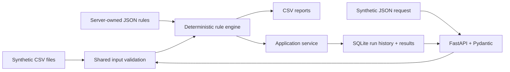

# Behavioral Health Documentation Validator

A portfolio-safe Python automation service that compares **synthetic**
behavioral-health appointment and documentation records, applies configurable
deterministic rules, persists validation history, and exposes auditable results
through CSV reports and a REST API.

> **Data safety:** This repository contains no real patient information, PHI, real
> provider data, employer files, credentials, or proprietary EHR rules. Every ID
> and record is invented for demonstration. The project flags operational data
> conditions; it does not make clinical, billing, compliance, or employment
> decisions.

## Current status

Phases 1 and 2 are complete. The original CSV command-line workflow remains
available, and the same deterministic engine now powers a local FastAPI service.
Successful API batches receive unique UUID run IDs and are stored transactionally
in SQLite so run history, results, and exceptions can be retrieved later.

## Business problem

Behavioral-health operations can involve repetitive reconciliation between
scheduled appointments and clinical documentation. Staff need to identify
completed appointments with missing or unsigned notes, distinguish appointments
that do not require documentation, and route ambiguous mismatches for human
review. Manual spreadsheet comparison is slow and can apply rules inconsistently.

## Solution

This project converts that workflow into a small, traceable automation product:



The authoritative match key is `appointment_id`. For appointments whose status
requires documentation, patient, provider, and date fields are consistency
checks; the validator never uses fuzzy matching to invent a link. Cancelled,
rescheduled, and default-policy no-show appointments are classified by lifecycle
status before note checks. Ambiguous conditions are surfaced for a person to
decide.

## Why this is a strong portfolio workflow

The project demonstrates more than calling an automation tool:

- translating operational rules into explicit, tested decision logic;
- separating deterministic exceptions from cases requiring judgment;
- validating data contracts and failing with useful error messages;
- making rule behavior configurable without creating a custom rules language;
- calculating provider metrics with a documented denominator;
- producing repeatable, machine-readable artifacts from a CLI;
- modeling relational run history and atomic database transactions;
- designing versioned REST endpoints, typed JSON contracts, pagination, and
  stable error responses; and
- using synthetic, minimum-necessary fields for a public portfolio project.

**My role:** workflow analysis, rule definition, automation design,
implementation, testing, reporting, and process-improvement documentation.

## Implemented scope

Included in Phase 1:

- synthetic CSV fixtures with opaque patient, provider, appointment, and note IDs;
- required-column, required-value, date-format, and unique-key validation;
- configurable status mappings, no-show policy, date tolerance, and a
  caller-managed rules version label;
- deterministic rule precedence with stable `rule_code` and `issue_codes` fields;
- explicit handling for duplicate matching notes and orphan documentation;
- detailed, provider-summary, and exceptions-only CSV reports;
- logging, a command-line interface, and example outputs.

Added in Phase 2:

- a shared in-memory service used by both CSV and API adapters;
- SQLite schema versioning, UUID run IDs, UTC timestamps, and run history;
- atomic persistence of run metadata and every detailed validation result;
- persisted exceptions selected from results without duplicating state;
- FastAPI/Pydantic JSON request and response models;
- health, create-run, history, detail, results, and exceptions endpoints;
- consistent `422`, `404`, `500`, and `503` JSON error envelopes;
- pagination and a REST `Location` header for newly created runs; and
- 61 automated rule, pipeline, persistence, transaction, and API tests.

Intentionally deferred:

- n8n orchestration, webhook/retry behavior, and idempotency keys;
- a dashboard and reviewer disposition workflow;
- optional AI summaries that never alter deterministic results;
- CI, screenshots, and optional Docker packaging.

## Quick start

Requirements: Python 3.11 or newer.

### Windows PowerShell

```powershell
python -m venv .venv
.\.venv\Scripts\python.exe -m pip install -e ".[dev]"
```

Run the original CSV workflow:

```powershell
.\.venv\Scripts\python.exe -m bh_doc_validator `
  --appointments data/sample/appointments.csv `
  --documentation data/sample/documentation.csv `
  --config config/validation_rules.json `
  --output-dir output
```

### macOS or Linux

```bash
python -m venv .venv
.venv/bin/python -m pip install -e '.[dev]'
```

Run the original CSV workflow:

```bash
.venv/bin/python -m bh_doc_validator \
  --appointments data/sample/appointments.csv \
  --documentation data/sample/documentation.csv \
  --config config/validation_rules.json \
  --output-dir output
```

The sample run produces:

```text
Validated 12 appointments.
Valid documentation: 2
Exceptions: 8
```

Generated files:

- `validation_report.csv`: one row per appointment plus explicit orphan-note rows;
- `provider_summary.csv`: workload, exception, review, and completion metrics; and
- `exceptions_report.csv`: deterministic exceptions and human-review cases only.

Reproducible repository examples are available in
[`examples/output`](examples/output).

## REST API and SQLite run history

Start the API locally from the repository root:

```powershell
.\.venv\Scripts\python.exe -m uvicorn bh_doc_validator.api:app `
  --host 127.0.0.1 --port 8000
```

Open `http://127.0.0.1:8000/docs` for FastAPI's interactive OpenAPI interface.
The documented launch command intentionally binds to localhost for this
portfolio phase.

Submit the committed synthetic JSON example from a second PowerShell window:

```powershell
Invoke-RestMethod `
  -Method Post `
  -Uri http://127.0.0.1:8000/api/v1/runs `
  -ContentType application/json `
  -InFile data/sample/validation_request.json
```

Successful creation returns `201 Created`, a UUID, UTC timestamp, rules version,
and summary counts. It also includes a `Location` response header for the new run.

| Method | Endpoint | Purpose |
|---|---|---|
| `GET` | `/health` | Confirm the local API can access SQLite |
| `POST` | `/api/v1/runs` | Validate a JSON batch and atomically persist it |
| `GET` | `/api/v1/runs` | Retrieve paginated run history, newest first |
| `GET` | `/api/v1/runs/{run_id}` | Retrieve one run's metadata |
| `GET` | `/api/v1/runs/{run_id}/results` | Retrieve persisted detailed results |
| `GET` | `/api/v1/runs/{run_id}/exceptions` | Retrieve only persisted exception rows |

The default database is `data/local/validator.sqlite3`, which Git ignores. Set
`BH_VALIDATOR_DATABASE_PATH` or `BH_VALIDATOR_CONFIG_PATH` before starting the
server to override the local paths. See [`docs/api.md`](docs/api.md) for the JSON
contract and error model.

SQLite uses two tables: `validation_runs` and `validation_results`. Exceptions
are result rows where `is_exception = 1`; there is no duplicate exception table
that could drift out of sync. Validation completes before a short write
transaction inserts the run and every result. Any insert failure rolls back the
whole run.

## Validation outcomes

| Condition | Primary result | Exception | Human review |
|---|---|---:|---:|
| Completed + one aligned signed note | `VALID` | No | No |
| Completed + no matching note | `MISSING_DOCUMENTATION` | Yes | No |
| Completed + one consistent unsigned note | `UNSIGNED_DOCUMENTATION` | Yes | No |
| Cancelled, rescheduled, or configured no-show | `NO_DOCUMENTATION_REQUIRED` | No | No |
| Patient/provider identity mismatch | `POSSIBLE_DATA_MISMATCH` | Yes | Yes |
| Date outside tolerance or signature inconsistency | `NEEDS_HUMAN_REVIEW` | Yes | Yes |
| Multiple matching notes, unknown status, or orphan note | `NEEDS_HUMAN_REVIEW` | Yes | Yes |

`is_exception` means the record belongs in an action queue. `requires_review`
specifically means deterministic logic cannot safely decide the case. A missing
or unsigned note is an exception, but it is not an ambiguous decision.

Rules are evaluated in a fixed, versioned order. Configuration can change
business parameters, but it cannot reorder precedence. See
[`docs/validation-rules.md`](docs/validation-rules.md) for the full decision
table and data contract.

## Provider completion percentage

The provider summary uses:

```text
valid completed appointments / appointments that require documentation * 100
```

Cancelled, rescheduled, no-show, unknown-status, and documentation-only records
are excluded from the denominator. A signed note with an unresolved mismatch is
not counted as valid. When a provider has no documentation-required appointments,
the percentage is blank rather than an invented 0%.

Sample provider output:

| provider_id | total | documentation required | valid | missing | unsigned | review cases | completion |
|---|---:|---:|---:|---:|---:|---:|---:|
| PROV-001 | 4 | 4 | 1 | 0 | 1 | 2 | 25.0% |
| PROV-002 | 4 | 2 | 0 | 1 | 0 | 2 | 0.0% |
| PROV-003 | 4 | 2 | 1 | 0 | 0 | 1 | 50.0% |

## Configuration

[`config/validation_rules.json`](config/validation_rules.json) contains the
small set of business parameters that should vary without code changes:

```json
{
  "rules_version": "1.0.0",
  "date_tolerance_days": 1,
  "no_show_policy": "no_documentation_required",
  "require_signed_date_for_signed_notes": true
}
```

The file also maps accepted appointment and note statuses. For example, changing
`no_show_policy` to `review` routes no-shows to `NEEDS_HUMAN_REVIEW` without
changing the validator code. `rules_version` is a caller-maintained label copied
to results; a configuration checksum is planned for stronger run traceability.

## Tests and verification

Run all tests:

```powershell
.\.venv\Scripts\python.exe -m pytest
```

Current verified result:

```text
61 passed
```

The suite covers every primary rule, the CSV regression path, precedence with
simultaneous issues, invalid inputs, SQLite schema initialization, persistence
across repository instances, UUID uniqueness, exception filtering, transaction
rollback, JSON typing, REST status codes, sanitized errors, pagination, and the
complete API workflow.

## Project structure

```text
config/                 Versioned validation parameters
data/sample/            Synthetic input fixtures
docs/                   Architecture and rule documentation
examples/output/        Reproducible sample reports
src/bh_doc_validator/   Rules, service, SQLite, API, pipeline, and CLI code
tests/                  Unit, persistence, API, and end-to-end tests
PORTFOLIO_PROGRESS.md   Completed work, learning evidence, and roadmap
```

See [`docs/architecture.md`](docs/architecture.md) for component boundaries and
the phased evolution plan.

## Limitations

- This is a portfolio MVP, not a production clinical or compliance system.
- API processing is synchronous and intended for small local synthetic batches.
- The input contract expects one unique appointment row and one unique `note_id`.
- Duplicate notes linked to one appointment are flagged rather than resolved.
- SQLite is appropriate for this single local service, not a scale claim.
- The API has no authentication, TLS, rate limiting, or request-size enforcement;
  it should remain bound to `127.0.0.1` during this portfolio phase.
- Failed input requests are not added to run history; only completed runs persist.
- Raw input payloads and provider summaries are not stored, minimizing retention.
- The system does not read narrative clinical content or assess clinical quality.
- There is no connection to any real EHR, employer system, or Office Ally account.

## Roadmap

1. **Phase 3 — n8n automation:** trigger the API with synthetic data, branch on
   exception counts, retrieve exceptions, create a local notification/review
   task, and add an idempotency key before enabling retries.
2. **Phase 4 — dashboard and portfolio polish:** add a lightweight run/exception
   dashboard, CI, screenshots, and optional packaging improvements.
3. **Later optional AI:** summarize exceptions or suggest review priority using
   persisted deterministic evidence. AI will never create or overwrite the
   source-of-truth validation result.
