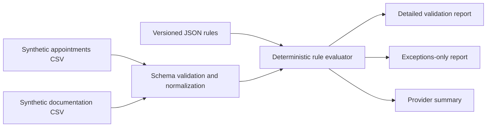

# Behavioral Health Documentation Validator

A portfolio-safe Python reconciliation pipeline that compares **synthetic**
behavioral-health appointment and documentation records, applies configurable
deterministic rules, and produces auditable exception and provider-summary
reports.

> **Data safety:** This repository contains no real patient information, PHI, real
> provider data, employer files, credentials, or proprietary EHR rules. Every ID
> and record is invented for demonstration. The project flags operational data
> conditions; it does not make clinical, billing, compliance, or employment
> decisions.

## Current status

Phase 1 is complete: the command-line MVP loads two CSV files, validates their
schemas, reconciles records by `appointment_id`, applies versioned rules, and
writes three reports. The included sample deliberately covers normal records and
edge cases, and the automated test suite verifies the business logic.

## Business problem

Behavioral-health operations can involve repetitive reconciliation between
scheduled appointments and clinical documentation. Staff need to identify
completed appointments with missing or unsigned notes, distinguish appointments
that do not require documentation, and route ambiguous mismatches for human
review. Manual spreadsheet comparison is slow and can apply rules inconsistently.

## Solution

This project converts that workflow into a small, traceable automation product:



The authoritative match key is `appointment_id`. For appointments whose status
requires documentation, patient, provider, and date fields are consistency
checks; the validator never uses fuzzy matching to invent a link. Cancelled,
rescheduled, and default-policy no-show appointments are classified by lifecycle
status before note checks. Ambiguous conditions are surfaced for a person to
decide.

## Why this is a strong portfolio workflow

The project demonstrates more than calling an automation tool:

- translating operational rules into explicit, tested decision logic;
- separating deterministic exceptions from cases requiring judgment;
- validating data contracts and failing with useful error messages;
- making rule behavior configurable without creating a custom rules language;
- calculating provider metrics with a documented denominator;
- producing repeatable, machine-readable artifacts from a CLI; and
- using synthetic, minimum-necessary fields for a public portfolio project.

**My role:** workflow analysis, rule definition, automation design,
implementation, testing, reporting, and process-improvement documentation.

## MVP scope

Included in Phase 1:

- synthetic CSV fixtures with opaque patient, provider, appointment, and note IDs;
- required-column, required-value, date-format, and unique-key validation;
- configurable status mappings, no-show policy, date tolerance, and a
  caller-managed rules version label;
- deterministic rule precedence with stable `rule_code` and `issue_codes` fields;
- explicit handling for duplicate matching notes and orphan documentation;
- detailed, provider-summary, and exceptions-only CSV reports;
- logging, a command-line interface, 31 automated tests, and example outputs.

Intentionally deferred until the core rules are trustworthy:

- SQLite run history and a small dashboard;
- a REST API and meaningful local n8n orchestration;
- CI, screenshots, and optional Docker packaging;
- optional AI-generated summaries that never alter deterministic results.

## Quick start

Requirements: Python 3.11 or newer.

### Windows PowerShell

```powershell
python -m venv .venv
.\.venv\Scripts\python.exe -m pip install -e ".[dev]"
.\.venv\Scripts\python.exe -m bh_doc_validator `
  --appointments data/sample/appointments.csv `
  --documentation data/sample/documentation.csv `
  --config config/validation_rules.json `
  --output-dir output
```

### macOS or Linux

```bash
python -m venv .venv
.venv/bin/python -m pip install -e '.[dev]'
.venv/bin/python -m bh_doc_validator \
  --appointments data/sample/appointments.csv \
  --documentation data/sample/documentation.csv \
  --config config/validation_rules.json \
  --output-dir output
```

The sample run produces:

```text
Validated 12 appointments.
Valid documentation: 2
Exceptions: 8
```

Generated files:

- `validation_report.csv`: one row per appointment plus explicit orphan-note rows;
- `provider_summary.csv`: workload, exception, review, and completion metrics; and
- `exceptions_report.csv`: deterministic exceptions and human-review cases only.

Reproducible repository examples are available in
[`examples/output`](examples/output).

## Validation outcomes

| Condition | Primary result | Exception | Human review |
|---|---|---:|---:|
| Completed + one aligned signed note | `VALID` | No | No |
| Completed + no matching note | `MISSING_DOCUMENTATION` | Yes | No |
| Completed + one consistent unsigned note | `UNSIGNED_DOCUMENTATION` | Yes | No |
| Cancelled, rescheduled, or configured no-show | `NO_DOCUMENTATION_REQUIRED` | No | No |
| Patient/provider identity mismatch | `POSSIBLE_DATA_MISMATCH` | Yes | Yes |
| Date outside tolerance or signature inconsistency | `NEEDS_HUMAN_REVIEW` | Yes | Yes |
| Multiple matching notes, unknown status, or orphan note | `NEEDS_HUMAN_REVIEW` | Yes | Yes |

`is_exception` means the record belongs in an action queue. `requires_review`
specifically means deterministic logic cannot safely decide the case. A missing
or unsigned note is an exception, but it is not an ambiguous decision.

Rules are evaluated in a fixed, versioned order. Configuration can change
business parameters, but it cannot reorder precedence. See
[`docs/validation-rules.md`](docs/validation-rules.md) for the full decision
table and data contract.

## Provider completion percentage

The provider summary uses:

```text
valid completed appointments / appointments that require documentation * 100
```

Cancelled, rescheduled, no-show, unknown-status, and documentation-only records
are excluded from the denominator. A signed note with an unresolved mismatch is
not counted as valid. When a provider has no documentation-required appointments,
the percentage is blank rather than an invented 0%.

Sample provider output:

| provider_id | total | documentation required | valid | missing | unsigned | review cases | completion |
|---|---:|---:|---:|---:|---:|---:|---:|
| PROV-001 | 4 | 4 | 1 | 0 | 1 | 2 | 25.0% |
| PROV-002 | 4 | 2 | 0 | 1 | 0 | 2 | 0.0% |
| PROV-003 | 4 | 2 | 1 | 0 | 0 | 1 | 50.0% |

## Configuration

[`config/validation_rules.json`](config/validation_rules.json) contains the
small set of business parameters that should vary without code changes:

```json
{
  "rules_version": "1.0.0",
  "date_tolerance_days": 1,
  "no_show_policy": "no_documentation_required",
  "require_signed_date_for_signed_notes": true
}
```

The file also maps accepted appointment and note statuses. For example, changing
`no_show_policy` to `review` routes no-shows to `NEEDS_HUMAN_REVIEW` without
changing the validator code. `rules_version` is a caller-maintained label copied
to results; a configuration checksum is planned for stronger run traceability.

## Tests and verification

Run all tests:

```powershell
.\.venv\Scripts\python.exe -m pytest
```

Current verified result:

```text
31 passed
```

The suite covers every primary rule, precedence with simultaneous issues,
inclusive date tolerance, configurable no-show behavior, duplicate and orphan
records, order independence, invalid inputs, invalid configuration, provider
metrics, and an end-to-end report-generation run.

## Project structure

```text
config/                 Versioned validation parameters
data/sample/            Synthetic input fixtures
docs/                   Architecture and rule documentation
examples/output/        Reproducible sample reports
src/bh_doc_validator/   Input, rules, reporting, pipeline, and CLI code
tests/                  Unit and end-to-end tests
PORTFOLIO_PROGRESS.md   Completed work, learning evidence, and roadmap
```

See [`docs/architecture.md`](docs/architecture.md) for component boundaries and
the phased evolution plan.

## Limitations

- This is a portfolio MVP, not a production clinical or compliance system.
- CSVs are processed as a batch; there is no database or run history yet.
- The input contract expects one unique appointment row and one unique `note_id`.
- Duplicate notes linked to one appointment are flagged rather than resolved.
- The system does not read narrative clinical content or assess clinical quality.
- There is no connection to any real EHR, employer system, or Office Ally account.

## Roadmap

1. **Phase 2 — operational visibility:** SQLite persistence and a lightweight
   dashboard for filters, metrics, and review queues.
2. **Phase 3 — integration:** a small REST endpoint plus an exported local n8n
   workflow that triggers validation, stores results, and creates a demo alert.
3. **Phase 4 — hardening:** CI, screenshots, optional Docker, run manifests,
   expanded negative tests, and performance checks.
4. **Phase 5 — optional assistive AI:** natural-language operations summaries or
   prioritization suggestions, clearly labeled and always subject to human review.
