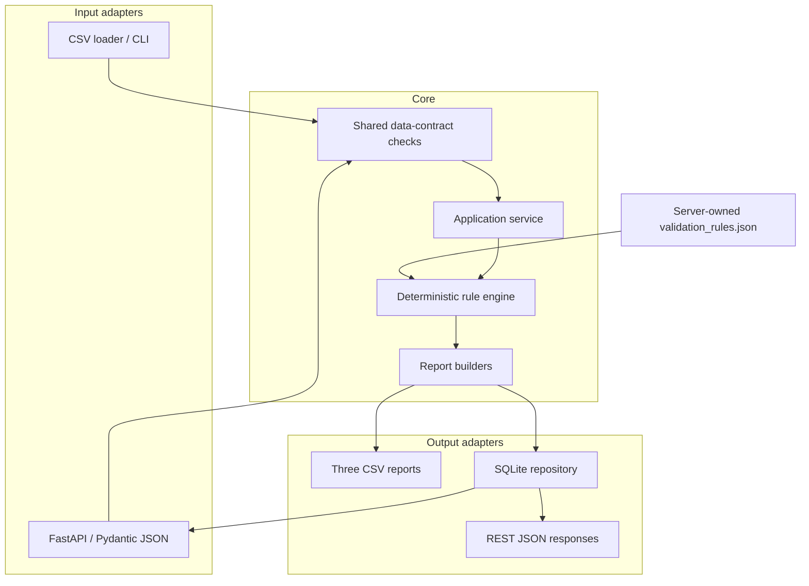

# Architecture and phased plan

## Architecture goal

The design keeps the deterministic rule engine at the center and treats CSV,
HTTP, SQLite, and future n8n/dashboard components as adapters around it. The API
does not reimplement any validation rule.



## Component responsibilities

| Component | Responsibility | What it deliberately does not do |
|---|---|---|
| `io.py` | Normalize and enforce required columns/values/dates/unique IDs for CSV and JSON adapters | Apply business outcomes |
| `config.py` | Load JSON parameters and reject invalid or overlapping status mappings | Allow arbitrary executable rules |
| `validation.py` | Match by exact appointment ID, apply precedence, preserve issue codes | Fuzzy-match people or make clinical judgments |
| `reporting.py` | Build exception and provider-level views with a defined denominator | Modify source records |
| `service.py` | Run shared in-memory validation and persist completed API runs | Reimplement deterministic rules |
| `pipeline.py` | Preserve the Phase 1 CSV-output workflow | Depend on FastAPI or SQLite |
| `cli.py` | Expose a reproducible user entry point and useful logs | Contain validation logic |
| `persistence.py` | Own schema version 1, transactions, history, and result queries | Store raw inputs or duplicate exceptions |
| `api_models.py` | Define typed request/response JSON contracts | Perform pandas or SQL work |
| `api.py` | Map HTTP requests, responses, and errors onto the service/repository | Accept server file paths or change policy rules |

## Key design decisions

### Exact matching, then consistency checks

`appointment_id` is the only authoritative link. For documentation-required
appointments, patient ID, provider ID, and note date are checked for consistency.
Lifecycle statuses that do not require documentation are classified first and do
not undergo note-consistency checks in Phase 1. A future candidate-match feature
may suggest likely links, but it must never silently link records.

### Outcome, exception, and review are separate

- `validation_result` is the primary outcome chosen by fixed precedence.
- `issue_codes` preserves all detected conditions even if only one primary result
  can be selected.
- `is_exception` controls the operational exception queue.
- `requires_review` is reserved for ambiguity that needs human judgment.

This avoids labeling a clearly missing note as an ambiguous decision while still
keeping it in the exceptions report.

### Configuration has a narrow boundary

Status aliases, no-show handling, date tolerance, signature-date enforcement,
and the rules version can change in JSON. Rule precedence stays in versioned code
and tests. A custom rules engine would add complexity without improving this MVP.

### Data-quality failures have explicit behavior

Malformed required values, invalid dates, and duplicate primary IDs fail the run
with an actionable message. Multiple distinct notes for one appointment and
documentation without a matching appointment remain valid input but become
review exceptions. No record is silently selected or discarded.

### One source of truth, multiple adapters

Both CSV and API records pass through the same input checks and
`validate_records()` implementation. The shared service builds detailed,
exception, and provider-summary DataFrames in memory. The CSV adapter writes
those frames to files; the API adapter stores the detailed frame in SQLite.

### Minimal relational persistence

SQLite schema version 1 has two tables:

```text
validation_runs (one row per completed UUID run)
    └── validation_results (ordered detailed rows for that run)
```

`validation_runs` stores UTC creation time, source, rules version, and counts.
`validation_results` stores all 18 Phase 1 detailed-result fields with a foreign
key and stable order. Exceptions are ordinary persisted results selected with
`is_exception = 1`; a second exception table would duplicate state.

Input validation and deterministic evaluation finish before the database write.
One short transaction inserts the run and all results. An error rolls back both,
so history can never contain a partially written completed run.

### Synchronous local API

The endpoints use normal synchronous `def` functions because pandas and standard
library `sqlite3` are synchronous. FastAPI runs them in a worker thread, while
the repository opens a fresh SQLite connection for each operation. Async database
libraries, pools, background workers, and queues would not improve this small
local workload.

The API accepts inline JSON arrays rather than local file paths. That boundary is
portable to n8n and avoids arbitrary server file access. Rules remain server
owned, and the supported launch command binds to localhost during this phase.

## MVP acceptance criteria

Phase 1 is complete when:

1. one command processes the included synthetic inputs;
2. three output reports are created with stable schemas;
3. every documented rule branch has an automated test;
4. malformed inputs fail with a useful explanation;
5. the sample produces known counts and provider metrics; and
6. the repository explains its privacy boundary and limitations.

All six criteria are currently met.

## Phase 2 acceptance criteria

Phase 2 is complete when:

1. every successful run receives a unique UUID and timezone-aware UTC timestamp;
2. run metadata and detailed results survive repository/application restart;
3. a failed insert rolls back the entire run;
4. JSON requests invoke the same deterministic engine as the CSV workflow;
5. history, detail, results, and exceptions can be retrieved through versioned
   REST endpoints;
6. invalid requests and infrastructure failures return stable, sanitized errors;
7. the original Phase 1 behavior and tests remain green; and
8. the public sample can be submitted without paid or external services.

All eight criteria are currently met.

## Phased development plan

### Phase 1 — trusted rule engine (complete)

Build the synthetic data contract, JSON configuration, validation logic, CLI,
reports, tests, example artifacts, and portfolio documentation.

Professional value: rule analysis, Python/pandas, error handling, testing,
auditability, and operational reporting.

### Phase 2 — SQLite persistence and REST API (complete)

Add a shared service, SQLite run history, atomic result persistence, unique run
IDs, typed JSON request/response models, versioned FastAPI endpoints, pagination,
and consistent error handling. Retain CSV as a separate working adapter.

Professional value: relational modeling, SQL transactions, repository patterns,
REST/HTTP, JSON schemas, dependency boundaries, and API testing.

### Phase 3 — n8n automation integration

Create an n8n workflow that transforms a synthetic input, invokes the existing
API, branches on `exception_count`, retrieves exception details, and creates a
local/demo notification or human-review task. Add an idempotency key before
enabling retry behavior, then commit the n8n JSON export.

Professional value: APIs, HTTP/JSON, orchestration, branching, retry/error paths,
and integration testing.

### Phase 4 — dashboard, selected AI, and presentation

Add a lightweight run/exception dashboard, reviewer disposition only if needed,
GitHub Actions, screenshots, and optional packaging. Carefully selected AI may
summarize deterministic exceptions or suggest review priority, but it must cite
source issue codes and never write validation outcomes.

Professional value: CI, reproducibility, packaging, observability, and technical
communication.

## Avoided overengineering

The MVP intentionally avoids microservices, Postgres, an ORM, queues, React,
Kubernetes, fuzzy identity matching, FHIR simulation, authentication claims, and
LLM-based validation. SQLite uses schema versioning without Alembic because only
schema version 1 exists. Those technologies can be added only after a concrete
requirement earns their complexity.
