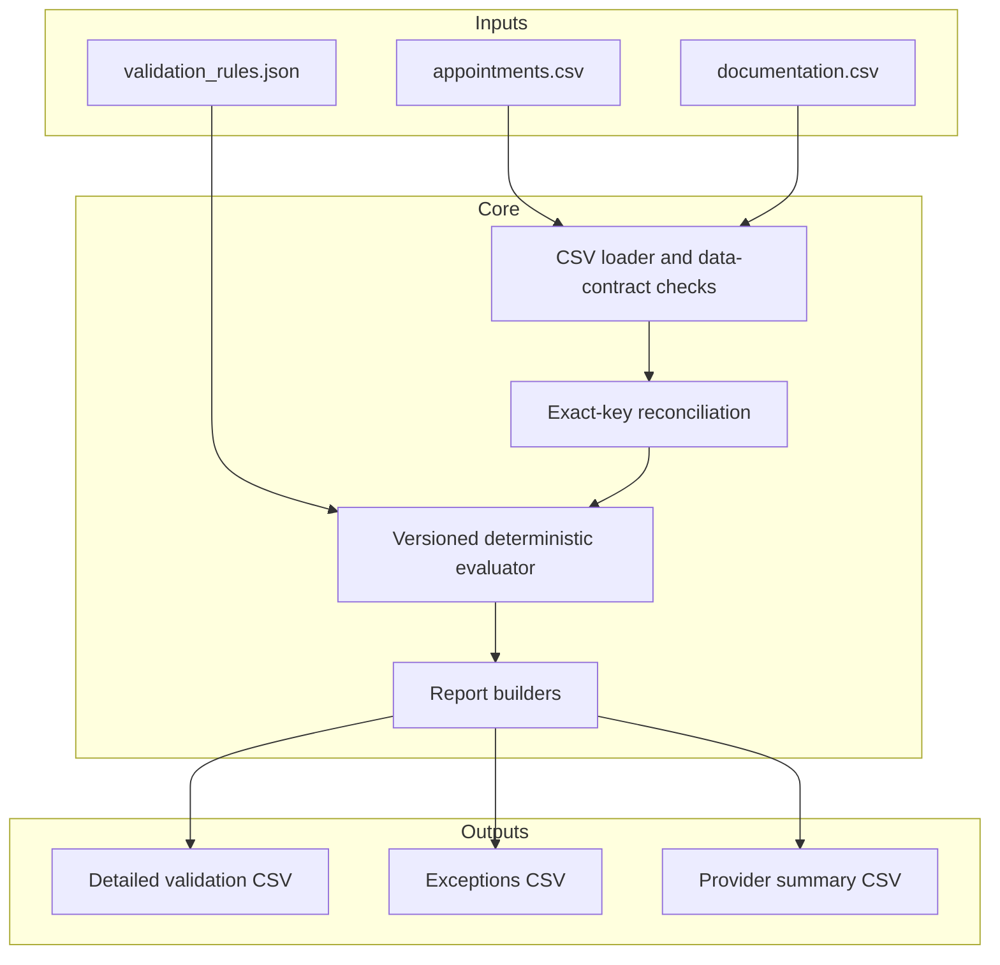

# Architecture and phased plan

## Architecture goal

The design keeps the deterministic rule engine at the center and treats files,
future APIs, databases, dashboards, and n8n as adapters around it. This makes the
business logic easy to test without starting external services.

## Component responsibilities

| Component | Responsibility | What it deliberately does not do |
|---|---|---|
| `io.py` | Load CSVs, normalize whitespace, enforce required columns/values/dates/unique IDs | Apply business outcomes |
| `config.py` | Load JSON parameters and reject invalid or overlapping status mappings | Allow arbitrary executable rules |
| `validation.py` | Match by exact appointment ID, apply precedence, preserve issue codes | Fuzzy-match people or make clinical judgments |
| `reporting.py` | Build exception and provider-level views with a defined denominator | Modify source records |
| `pipeline.py` | Orchestrate one batch and write outputs | Hide expected failures or depend on a UI |
| `cli.py` | Expose a reproducible user entry point and useful logs | Contain validation logic |

## Key design decisions

### Exact matching, then consistency checks

`appointment_id` is the only authoritative link. For documentation-required
appointments, patient ID, provider ID, and note date are checked for consistency.
Lifecycle statuses that do not require documentation are classified first and do
not undergo note-consistency checks in Phase 1. A future candidate-match feature
may suggest likely links, but it must never silently link records.

### Outcome, exception, and review are separate

- `validation_result` is the primary outcome chosen by fixed precedence.
- `issue_codes` preserves all detected conditions even if only one primary result
  can be selected.
- `is_exception` controls the operational exception queue.
- `requires_review` is reserved for ambiguity that needs human judgment.

This avoids labeling a clearly missing note as an ambiguous decision while still
keeping it in the exceptions report.

### Configuration has a narrow boundary

Status aliases, no-show handling, date tolerance, signature-date enforcement,
and the rules version can change in JSON. Rule precedence stays in versioned code
and tests. A custom rules engine would add complexity without improving this MVP.

### Data-quality failures have explicit behavior

Malformed required values, invalid dates, and duplicate primary IDs fail the run
with an actionable message. Multiple distinct notes for one appointment and
documentation without a matching appointment remain valid input but become
review exceptions. No record is silently selected or discarded.

## MVP acceptance criteria

Phase 1 is complete when:

1. one command processes the included synthetic inputs;
2. three output reports are created with stable schemas;
3. every documented rule branch has an automated test;
4. malformed inputs fail with a useful explanation;
5. the sample produces known counts and provider metrics; and
6. the repository explains its privacy boundary and limitations.

All six criteria are currently met.

## Phased development plan

### Phase 1 — trusted rule engine (complete)

Build the synthetic data contract, JSON configuration, validation logic, CLI,
reports, tests, example artifacts, and portfolio documentation.

Professional value: rule analysis, Python/pandas, error handling, testing,
auditability, and operational reporting.

### Phase 2 — persistence and review experience

Add SQLite tables for runs and validation results, then a small dashboard that
shows KPIs, provider filters, exception categories, and a review queue. Retain CSV
as the simplest import/export format.

Professional value: data modeling, SQL, state management, and user-centered
workflow design.

### Phase 3 — automation integration

Wrap the pipeline in a small REST API. Create an n8n workflow that receives a new
synthetic batch, invokes validation, checks the response, persists results, and
sends a local/demo notification when exceptions exist. Commit the n8n JSON export.

Professional value: APIs, HTTP/JSON, orchestration, branching, retry/error paths,
and integration testing.

### Phase 4 — hardening and presentation

Add GitHub Actions, screenshots, an end-to-end architecture image, an optional
Dockerfile, structured run manifests, performance measurements, and an expanded
edge-case suite.

Professional value: CI, reproducibility, packaging, observability, and technical
communication.

### Phase 5 — optional assistive AI

Only after deterministic outputs are stable, optionally summarize a run or rank
ambiguous exceptions. AI output must be labeled as a suggestion, must cite the
underlying deterministic issue codes, and must never overwrite validation results
without a human decision.

Professional value: appropriate AI boundaries, prompt/output contracts, and
human-in-the-loop design.

## Avoided overengineering

The MVP intentionally avoids microservices, Postgres, an ORM, queues, React,
Kubernetes, fuzzy identity matching, FHIR simulation, and LLM-based validation.
Those technologies can obscure the operational reasoning before the core process
has earned additional infrastructure.
