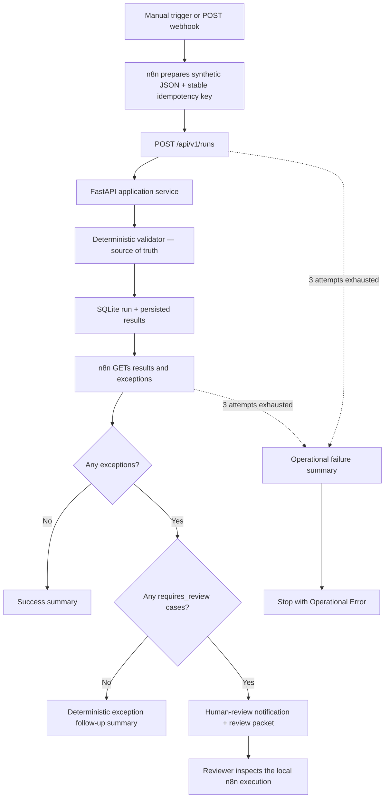

# Phase 3 n8n automation workflow

## Purpose

The exported workflow turns the validator API into a retry-safe automation. It
uses only built-in n8n nodes, local FastAPI, SQLite, and synthetic records. No
LLM, paid integration, credentials, or real health data is required.

The workflow is committed at
[`n8n/workflows/behavioral-health-validation.json`](../n8n/workflows/behavioral-health-validation.json).
It was imported and executed with n8n `2.34.6` during Phase 3 verification.

## Workflow diagram



n8n orchestrates the process but never calculates or edits a validation result.
It branches only on `is_exception`, `requires_review`, and counts returned by the
deterministic service.

## Practical idempotency

An automation can lose a network response even after the API completed the
request. Retrying a normal POST would then create a second run. The workflow
prevents that by sending one stable `Idempotency-Key` for the logical job.

- First key + request: the API creates a run and returns `201 Created`.
- Same key + same normalized request: the API returns the original run with
  `200 OK` and `Idempotency-Replayed: true`.
- Same key + different request: the API returns `409 IDEMPOTENCY_CONFLICT`.
- A failed validation or failed database transaction does not reserve the key.

SQLite stores the key and a SHA-256 request fingerprint with the completed run.
A partial unique index and one transaction make the check-and-insert operation
safe even when two retries arrive concurrently. The raw request is not retained.
The header remains optional for older Phase 2 clients, but this n8n workflow
always supplies it.

For webhook executions, the caller should send a stable `job_id`. The workflow
turns `phase3-job-001` into `n8n-phase3:phase3-job-001`. Use the same job ID for
retries of one logical event and a new job ID for genuinely new work. The manual
demo uses a stable scenario-specific key so repeatedly clicking Execute does not
pollute run history.

## Node-by-node explanation

| # | Node | What it does |
|---:|---|---|
| 1 | `Manual Trigger` | Starts a one-click local portfolio demonstration. |
| 2 | `Validation Webhook` | Accepts a POST event and immediately returns `202 Accepted` while the workflow continues. |
| 3 | `Prepare Synthetic Request` | Selects a committed synthetic scenario, builds the JSON request, and creates or validates the stable retry key. |
| 4 | `Create Validation Run` | POSTs JSON and `Idempotency-Key` to FastAPI. It makes at most three attempts, two seconds apart. |
| 5 | `Store Run Context` | Extracts and carries the returned `run_id`, HTTP status, replay flag, API URL, and counts. |
| 6 | `Fetch Persisted Results` | GETs the detailed result collection for that exact UUID. |
| 7 | `Store Results Context` | Keeps the run metadata and fetched result rows together for later steps. |
| 8 | `Fetch Persisted Exceptions` | GETs only rows where the API persisted `is_exception = true`. |
| 9 | `Assemble Workflow Context` | Adds exception rows and filters `requires_review = true` into a review list. |
| 10 | `Any Exceptions?` | Sends zero-exception runs to success and exception runs to routing. |
| 11 | `Build Clean Summary` | Produces `SUCCESS_NO_EXCEPTIONS` with operational counts. |
| 12 | `Any Human Review?` | Separates clear deterministic follow-up from ambiguous cases needing judgment. |
| 13 | `Build Exception Summary` | Produces `EXCEPTIONS_ROUTED_NO_HUMAN_REVIEW` for clear exceptions such as a missing note. |
| 14 | `Prepare Human Review Notification` | Produces `AWAITING_HUMAN_REVIEW`, a compact review packet, and a local notification in the n8n execution output. |
| 15–17 | `Mark ... Failure` | Convert a final POST, results GET, or exceptions GET failure into a stage-specific operational error. |
| 18 | `Stop with Operational Error` | Deliberately marks the execution failed so operations cannot mistake it for success. |

Four sticky notes in the export explain the trigger, API calls, routing, and
human-review boundary directly on the n8n canvas.

## Synthetic scenarios

The webhook accepts one of these optional `scenario` values:

| Scenario | Expected final node | Expected counts |
|---|---|---|
| `review` (default) | `Prepare Human Review Notification` | 4 results, 2 exceptions, 1 review case |
| `clean` | `Build Clean Summary` | 1 result, 0 exceptions, 0 review cases |
| `deterministic_exception` | `Build Exception Summary` | 1 result, 1 exception, 0 review cases |

The review scenario deliberately contains one valid signed note, one completed
appointment with no note, one provider mismatch, and one cancelled appointment.
This makes the routing easy to inspect without using a large or realistic data
extract.

## Run locally

Start FastAPI from the repository root:

```powershell
.\.venv\Scripts\python.exe -m uvicorn bh_doc_validator.api:app `
  --host 127.0.0.1 --port 8000
```

In another terminal, start the pinned n8n version. The following is the exact
development command used for verification with pnpm 11 and Node 24:

```powershell
pnpm dlx --allow-build=sqlite3 n8n@2.34.6
```

Open `http://127.0.0.1:5678`, complete n8n's local owner setup, import the
committed workflow JSON, and publish it. Run it manually, or call the production
webhook:

```powershell
$body = @{
  job_id = "portfolio-review-001"
  scenario = "review"
} | ConvertTo-Json

Invoke-RestMethod `
  -Method Post `
  -Uri http://127.0.0.1:5678/webhook/behavioral-health-validation `
  -ContentType application/json `
  -Body $body
```

The webhook returns `202` with an n8n execution ID. Open that execution to see
the stored UUID, result retrieval, branches, summary, or review packet. Repeating
the same `job_id` and scenario must return the same validator run rather than
create another row.

If n8n runs in Docker while FastAPI runs on the host, edit the preparation node's
API URL to `http://host.docker.internal:8000`; `127.0.0.1` inside a container
refers to the container itself.

## Error and security boundaries

- Every HTTP node uses three bounded attempts with a 2,000 ms wait and a
  dedicated error output. `Never Error` is deliberately off.
- GET retries are naturally read-only. POST retries are safe because the key is
  stable before the HTTP node starts retrying.
- The local review notification is intentionally free and credentialless. A
  future email, Slack, or ticket adapter can replace it without changing the
  validator.
- The webhook has no authentication in this portfolio phase. Keep n8n and the API
  local. A deployed system would add authentication, TLS, rate limits, payload
  size limits, and a proper notification destination.
- Result and exception GETs use the API's maximum page size of 200. A larger real
  workflow would loop through pagination.
- No LLM is present. AI is unnecessary for deterministic matching and rule
  evaluation.

## End-to-end verification evidence

Verified locally on 2026-08-16 with n8n `2.34.6`, Node `24.19.0`, FastAPI
`0.141.1`, and a fresh temporary SQLite database:

| Scenario | Observed result |
|---|---|
| First complete review run | POST `201`, replay flag `false`, 4 results, 2 exceptions, 1 review case |
| Same logical job retried | POST `200`, replay flag `true`, same UUID, run count unchanged |
| Webhook trigger | HTTP `202`; n8n execution mode `webhook`; execution completed successfully |
| Clean scenario | `SUCCESS_NO_EXCEPTIONS`; 1 result and 0 exceptions |
| Deterministic exception | `EXCEPTIONS_ROUTED_NO_HUMAN_REVIEW`; 1 exception and 0 review cases |
| Review scenario | `AWAITING_HUMAN_REVIEW`; review packet contained the provider mismatch |
| FastAPI unavailable | Three configured attempts took about 4.1 seconds; execution ended through `Mark Create Failure` and `Stop with Operational Error` |

Repository tests also validate the workflow export's endpoints, node versions,
retry settings, error connections, branch structure, synthetic IDs, and absence
of credentials or AI nodes.

## What to understand for interviews

1. Idempotency protects a logical operation, not merely one HTTP request. The
   caller chooses a stable key; the server compares a canonical fingerprint and
   enforces uniqueness atomically.
2. `201` means this attempt created state; `200` plus a replay header means the
   desired state already existed; `409` means the caller misused a key.
3. A webhook is an event-driven trigger. Returning `202` acknowledges receipt;
   it does not claim that downstream validation has already finished.
4. n8n is the orchestrator, not the business-rules engine. It moves JSON, calls
   versioned endpoints, stores context, branches, retries, and exposes failures.
5. An exception is not automatically ambiguous. `is_exception` drives the
   action queue; `requires_review` defines the smaller human-judgment queue.
6. Retry policies must be bounded and paired with visible terminal failure. A
   workflow that silently continues after an API error is operationally unsafe.
7. Human review should add a disposition or follow-up action, never rewrite the
   deterministic evidence that caused the review.
